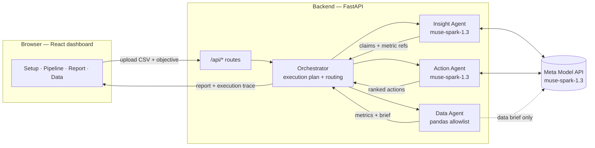

# Operon AI — Intelligence, Orchestrated.

Multi-agent business operations intelligence platform. Built for the **Meta Global AI Developer Hackathon 2026**.

Upload a CSV, describe a business objective, and watch Meta-powered agents analyze the data,
generate evidence-backed insights, and recommend prioritized actions.

## Architecture



**Request flow:** the dashboard uploads a CSV (`POST /api/upload`) and submits an objective
(`POST /api/analyze`). The orchestrator builds a deterministic `ExecutionPlan` from the
objective keywords and the CSV shape, then routes Data → Insight → Action sequentially.
Every genuine state transition (`queued → running → succeeded/failed/skipped`) is logged
with timestamps and returned as the execution trace — the UI renders exactly these events,
never simulated progress.

**Trust boundaries:**

- The model never executes code. The Data Agent runs only allowlisted pandas functions
  (`row_count`, `numeric_summary`, `groupby_sum/mean`, `top_values`, `trend_daily`,
  `correlation`, `column_profile`). Unknown functions, missing columns, and non-numeric
  fields fail safely into warnings.
- Every model response is validated against a Pydantic schema. Unknown metric references
  are dropped with a warning, never trusted.
- If the API key is missing or a call fails, the affected steps fail honestly and the
  report is marked **PARTIAL** with the deterministic analytics intact.

## Meta model usage

All generative AI goes through the **Meta Model API** (`https://api.meta.ai/v1`,
model `muse-spark-1.3`) via a single client module (`backend/app/meta_client.py`).
No OpenAI, Anthropic, Gemini, or other third-party LLM calls exist anywhere in the
codebase. The three LLM call sites:

| Caller | Purpose | Validated as |
| ------ | ------- | ------------ |
| Data Agent brief | 3–5 sentence summary of what the data covers | `DataBriefResponse` |
| Insight Agent | 3–5 claims with evidence + metric ids | `InsightListResponse` |
| Action Agent | 3–5 ranked actions with impact + uncertainty | `ActionListResponse` |

Transient failures (timeouts, 429/5xx, malformed JSON) get bounded retries
(`LLM_MAX_RETRIES`, default 2); persistent failures raise `MetaAPIError` and mark
the run partial. `MODEL_API_KEY` lives server-side only (`backend/.env`, git-ignored);
the frontend only ever sees the boolean `llm_configured`.

## Setup

Prerequisites: Python 3.12+, Node.js 18+.

```powershell
# 1. Backend
cd backend
copy .env.example .env
# Edit .env and set MODEL_API_KEY (from https://dev.meta.ai)
python -m venv .venv
.\.venv\Scripts\Activate.ps1
pip install -r requirements.txt
uvicorn app.main:app --port 8000
```

```powershell
# 2. Frontend (new terminal)
cd frontend
npm install
npm run dev
```

Open **http://localhost:5173** in a browser. The Vite dev server proxies `/api` to the backend.

macOS/Linux: use `cp .env.example .env`, `python3 -m venv .venv`, and `source .venv/bin/activate`.

### Configuration (`backend/.env`)

| Variable | Default | Description |
| -------- | ------- | ----------- |
| `MODEL_API_KEY` | *(empty)* | Meta Model API key — server-side only |
| `MODEL_API_URL` | `https://api.meta.ai/v1` | Meta Model API base URL |
| `MODEL_NAME` | `muse-spark-1.3` | Model used for ALL LLM inference |
| `CORS_ORIGINS` | `http://localhost:5173` | Allowed frontend origins |
| `MAX_UPLOAD_MB` | `25` | Max CSV upload size |
| `LLM_TIMEOUT_S` | `120` | Per-request model timeout |
| `LLM_MAX_RETRIES` | `2` | Bounded retries for transient failures |
| `LLM_RETRY_BACKOFF_S` | `1.0` | Linear backoff between retries |

## Demo instructions (2 minutes, no upload needed)

1. Click **"Load Sample Dataset"** (600 synthetic retail transactions, `backend/data/sample_sales.csv`).
2. Keep or edit the sample objective.
3. Click **Run analysis** and watch the agent pipeline execute with real timings.
4. Review KPIs, the revenue chart (toggle series / point range), ranked insights with
   supporting numbers, and recommended actions with impact and uncertainty.
5. Check **Data provenance** for the source file, plan, and evidence counts, then
   **Export report (.md)**.

Without `MODEL_API_KEY` the demo still runs: deterministic KPIs, chart, metrics, and
provenance render, while LLM steps show as failed/skipped with an honest warning.

## API

| Method | Path | Description |
| ------ | ---- | ----------- |
| GET | `/api/health` | Status + whether the LLM is configured |
| POST | `/api/upload` | Upload CSV (`multipart/form-data`) |
| POST | `/api/analyze` | `{dataset_id?, csv_text?, objective}` → full report |
| GET | `/api/report/{run_id}` | Fetch a previous report |
| GET | `/api/report/{run_id}/download` | Download report as Markdown |
| GET | `/api/sample.csv` | Demo dataset |

## Deployment

- **Backend:** any Python host. `pip install -r requirements.txt`, set env vars
  (`MODEL_API_KEY`, `CORS_ORIGINS` to the frontend origin), run
  `uvicorn app.main:app --host 0.0.0.0 --port 8000`. No database or migrations.
- **Frontend:** `npm run build` produces a static `dist/` bundle; serve it from any
  static host and point `VITE_API_URL` (or the hosting proxy) at the backend so
  `/api` resolves. The dev-time Vite proxy is dev-only.
- **Notes:** storage is in-memory, so uploads and reports reset on backend restart
  (fine for demo/POC; add a store before multi-user use). Serve both tiers over
  HTTPS in production; keep `MODEL_API_KEY` out of client bundles and logs.

## Tests

```powershell
cd backend
.\.venv\Scripts\python.exe -m pytest tests\ -q
```

39 tests: pandas analytics correctness, allowlisted metrics vs the sample CSV,
sample-dataset reproducibility + independent validation, CSV validation,
full orchestrator pipeline (stubbed Meta client), evidence-linked
recommendations, missing-column safety, retry behavior, partial-report
behavior without a key, and all API handlers.

```powershell
cd frontend
npm run build   # typecheck (tsc) + production build
```

## Project layout

```
operon-ai/
├── backend/
│   ├── app/
│   │   ├── main.py          # FastAPI routes
│   │   ├── orchestrator.py  # Execution plan + Data → Insight → Action routing
│   │   ├── agents.py        # Data / Insight / Action agent implementations
│   │   ├── analytics.py     # Deterministic pandas profiling + allowlisted metrics
│   │   ├── meta_client.py   # Meta Model API client (muse-spark-1.3 only)
│   │   ├── models.py        # Pydantic schemas (plans, metrics, claims, reports)
│   │   ├── report.py        # Markdown report renderer
│   │   └── config.py        # Env config (MODEL_API_KEY server-side only)
│   ├── data/sample_sales.csv  # synthetic demo data (see data/README.md)
│   ├── scripts/             # generate_sample.py + validate_sample.py (seed 42)
│   ├── tests/               # pytest suite (analytics/orchestrator/api/engine/sample_dataset)
│   ├── requirements.txt
│   └── .env.example
├── frontend/
│   ├── src/
│   │   ├── App.tsx          # Sidebar layout, setup, sections, run history
│   │   ├── components.tsx   # Timeline, KPIs, chart, insights, actions, provenance
│   │   ├── api.ts           # Backend client (no secrets)
│   │   └── types.ts         # Report/plan/metric/agent-state types
│   ├── package.json
│   └── vite.config.ts       # /api proxy → localhost:8000
├── README.md
└── SUBMISSION.md            # Hackathon project description + feature status
```

## Limitations

- In-memory storage: datasets and reports vanish on backend restart.
- The `complete` path (live LLM insights/actions) requires a valid `MODEL_API_KEY`;
  without one, runs are honestly `partial`.
- CSV only (25 MB default cap, 500k rows / 200 columns); no Excel, JSON, or live
  database connectors.
- Single synchronous analysis request — no streaming progress (the UI shows an
  honest executing state until the report arrives) and no request cancellation.
- One analysis chart per report (time series preferred, else top-values bar).
- English-language prompts; no auth, multi-user isolation, or audit log.
